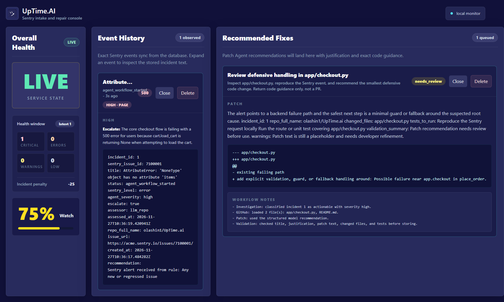

<div align="center">

# UpTime.ai

**An AI on-call assistant: it receives Sentry alerts, decides how severe each one is and whether to page someone, and drafts a code fix using the repo's source from GitHub.**


</div>



## 🌟 Highlights

- **Sentry webhook intake.** `POST /api/sentry/webhook` verifies the HMAC-SHA256 signature, parses the event (error, request context, in-app stack frames, tags, time), stores an incident, and hands it to the agents.
- **Severity + escalation assessment.** Each incident gets a severity (`high` / `medium` / `low`), an escalate yes/no, and a one-line reason from Gemini (`gemini-3.5-flash-lite`). It can optionally read the stack-trace files from GitHub first. The original keyword rules remain as the fallback if the model is unavailable.
- **Four Fetch.ai uAgents in a chain.** Investigation (assessment) → GitHub (loads source files) → Patch (drafts a fix) → Validation (checks the draft and stores it). They pass typed messages over local HTTP.
- **Live dashboard.** React polls the API every 4 s and shows each incident's assessment, the reason, and the validated patch recommendation.

## 📊 Evaluation

48 hand-labeled Sentry alerts (`eval/eval_errors.json`), with labels committed before any run. They point into a small shop backend in `eval/fixture_repo/`, which the repo-context mode reads from GitHub. 9 cases deliberately split severity from escalation, such as an outage that has already recovered, or a certificate expiring on a Friday night. Full method, error analysis and caveats: [`LEARNING.md`](LEARNING.md). Raw results: [`eval/results/`](eval/results/).

| Assessor | Severity accuracy | Escalation accuracy | False pages | Needed pages caught |
|---|---|---|---|---|
| Keyword rules (original) | 21/48 (43.8%) | 31/48 (64.6%) | 10 | 10/17 |
| Gemini, alert only | **32/48 (66.7%)** | 40/48 (83.3%) | 7 | **16/17** |
| Gemini + GitHub repo context | 31/48 (64.6%) | **43/48 (89.6%)** | **3** | 15/17 |

- **Does repo context help?** It helps escalation (+3 cases, false pages 7 → 3) but not severity (−1). It fixed 5 cases and broke 5, mostly by trusting reassuring code comments over the alert. Examples: a rejected payment webhook ("the provider retries for 72 hours"), and a live API key leaked into an error, which neither LLM mode recognized as a secret.
- **Latency, webhook received → assessment visible on the dashboard** (20 cases, real browser via Playwright): p50 **3.9 s**, p95 **8.0 s**, max 19.2 s. The server part is p50 1.6 s; the rest is the dashboard's 4 s polling. The Gemini call is p50 1.3 s.
- **Run-to-run consistency** (same 20 inputs, temperature 0): same escalation 20/20, same severity 18/20.

Gemini calls used for all of the above: 118 (counted in `eval/results/gemini_calls.log`).

## 🚀 Usage

Run the backend, the agents and the dashboard (below), then point a Sentry alert rule's webhook at `http://<host>:8010/api/sentry/webhook`. Each alert appears on the dashboard within a few seconds with its severity, the page/no-page decision and the reason. A patch recommendation follows in the right-hand column.

## ⬇️ Installation

```bash
# backend (Python 3.13 tested)
cd backend
python -m venv .venv
.venv/Scripts/python -m pip install -r requirements.txt   # bin/python on macOS/Linux
cp .env.example .env                                       # then fill in the values below

# frontend
cd ../frontend && npm ci
```

Settings (`backend/.env`; every key is listed with comments in `backend/.env.example`):

| Key | Needed for |
|---|---|
| `DEFAULT_REPO_FULL_NAME` | **Required** (or send `repo_full_name` in the payload): the repo to investigate |
| `GEMINI_API_KEY` | Severity/escalation by Gemini. Without it, the keyword rules are used |
| `SEVERITY_ASSESSOR` | `llm_repo` (default), `llm`, or `rules` |
| `GITHUB_TOKEN` | Private repos. Public repos are read without a token |
| `REPO_SOURCE_ROOT` | If stack-trace paths are relative to a subfolder of the repo |
| `SENTRY_WEBHOOK_SECRET` | Signature verification. **If unset, webhooks are not verified** |
| `ASI_ONE_API_KEY` | Patch drafting by ASI:One. Without it, a template recommendation is stored |

### Run

```bash
# terminal 1: API on :8010
cd backend && .venv/Scripts/python -m uvicorn app.main:app --port 8010
# terminal 2: the four agents on :8002-8005
cd backend && .venv/Scripts/python -m app.run_agents
# terminal 3: dashboard on :5173
cd frontend && npm run dev
```

### Tests and eval

```bash
backend/.venv/Scripts/python -m pytest -q backend/tests
backend/.venv/Scripts/python eval/run_eval.py --mode rules   # free baseline
backend/.venv/Scripts/python eval/score.py                   # rebuild metrics from saved results
```

Paid runs (Gemini) and the end-to-end latency run are listed in [`LEARNING.md`](LEARNING.md#reproduce-every-number).

## 🔌 API

| Method | Path | What it does |
|---|---|---|
| `POST` | `/api/sentry/webhook` | Receive a Sentry alert, store the incident, start the agents |
| `GET` | `/api/incidents/` | Incidents with Sentry level and the agent's severity, escalate and reason |
| `DELETE` | `/api/incidents/{id}` | Delete an incident and its recommendations |
| `GET` | `/api/recommendations/` | Validated patch recommendations |
| `DELETE` | `/api/recommendations/{id}` | Delete a recommendation |
| `GET` | `/api/health/` | Liveness |

## 🛠️ Tech Stack

| Category | Technologies |
| --- | --- |
| **Backend** | Python, FastAPI, SQLModel, SQLite |
| **Agents** | Fetch.ai uAgents (local endpoints, no Agentverse) |
| **AI** | Google Gemini via `google-genai` (assessment), ASI:One via the OpenAI SDK (patch drafting) |
| **Integrations** | Sentry webhooks, GitHub (PyGithub, or raw.githubusercontent.com for public repos) |
| **Frontend** | React 19, TypeScript, Vite, Tailwind CSS |
| **Eval** | Playwright (Chromium), labeled JSON test set |

## 🏗️ Architecture

When Sentry posts an alert:
1. The **webhook** verifies the signature, extracts the error, request context, in-app stack frames, tags and event time, saves an `Incident`, and sends it to the Investigation agent with the 5 most recent incidents.
2. The **Investigation agent** runs the assessor. In `llm_repo` mode it loads the stack-trace files and the README from GitHub, then asks Gemini for `{severity, escalate, reason}` as schema-checked JSON. It saves the result on the incident, which is what the dashboard shows. It then decides whether to continue to patching.
3. The **GitHub agent** loads source files for the patch.
4. The **Patch agent** drafts a recommendation: title, justification, diff and tests.
5. The **Validation agent** checks the draft (diff present, no model artifacts, tests suggested) and stores it as `approved` or `needs_review`.

Each step appends a line to `backend/workflow_trace.log`.

## ⚠️ Known limitations

- **The eval is synthetic.** 48 alerts written for a fixture repo, labeled by one person. Use the numbers as evidence about behavior, not as production accuracy.
- **Severity and urgency get mixed.** The model gets paging right on the 9 split cases (9/9 with context) but labels their severity wrong (1/9). It lowers severity for recovered outages and raises it for urgent-but-not-yet-harmful ones.
- **Secrets in errors aren't detected.** A leaked live key (eval case E11) wasn't recognized by any assessor; this needs a deterministic check.
- **No real paging.** The escalate decision is stored and shown; nothing sends a page.
- **Polling dashboard.** Adds 0–4 s; Server-Sent Events would remove it.
- **Patch drafts without an ASI:One key are a template**, and the workflow note still says "used the structured model recommendation". The draft's quality wasn't evaluated.
- **SQLite only.** `database.py` uses SQLite `PRAGMA` statements; no auth on the API.

## 📁 Project Structure

```text
UpTime.ai/
├── backend/
│   ├── app/
│   │   ├── agents/       # investigation, github, patch, validation (uAgents) + message models
│   │   ├── models/       # Incident, Recommendation (SQLModel)
│   │   ├── routes/       # sentry webhook, incidents, recommendations, health
│   │   └── services/     # severity_service (assessor), github_service, llm_service (patch)
│   ├── tests/
│   └── .env.example
├── frontend/src/         # React dashboard
├── eval/
│   ├── fixture_repo/     # small shop backend the eval alerts point into
│   ├── eval_errors.json  # 48 labeled Sentry webhooks
│   ├── build_eval_errors.py, run_eval.py, run_e2e.py, score.py
│   └── results/          # predictions, latency, metrics.md, Gemini call ledger
├── docs/dashboard.png
├── LEARNING.md           # what changed, why, and the numbers
└── README.md
```
